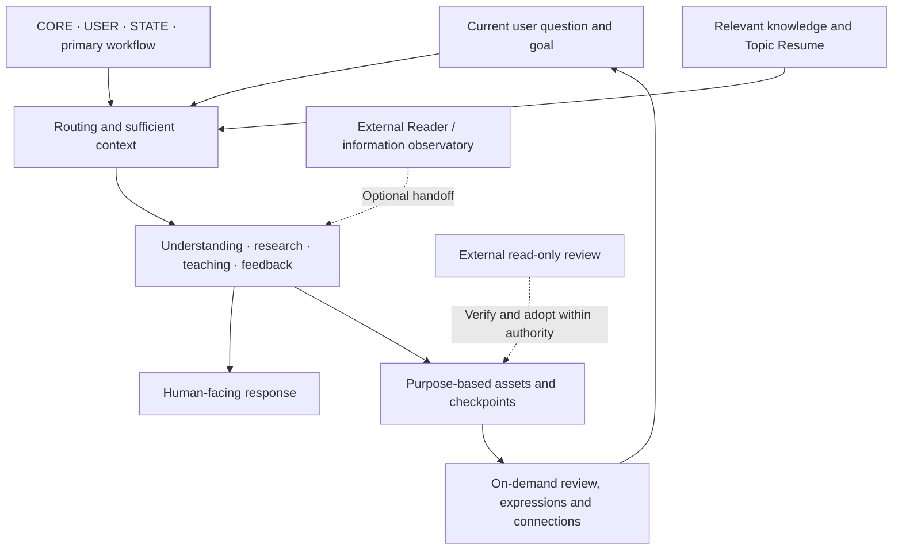

# Personal World Model Harness
[中文](README.md) · [English](README.en.md)

> **Let learning and experience across domains revise one personal world model.**

PWM is a long-lived cognitive collaboration system: AI helps explain, research, question, express and apply ideas; portable files preserve how understanding formed; that understanding can then participate in the next decision.

The question is not only “What did we save?” but **“Why did I think that, how did it change, and can I use it correctly now?”**

This reference edition reflects the current design reviewed through **2026-10-27**. It ships a Markdown workspace, operating protocols and public examples. Tools used in the originating private PWM are described separately from software actually included here.

[Start with the template](template/00_System/Home.md) · [Architecture](docs/architecture.md) · [Human-facing delivery](docs/human-facing-delivery.md) · [Evolution](docs/evolution.md) · [Changes](CHANGELOG.md)

## From cognitive audit to sustained collaboration

PWM began with an audit-inspired question: can fluent AI output become personal belief without sufficient attention to provenance, attribution and evidence?

Working papers, independent challenge, review gates and human adoption remain useful foundations. Experience also exposed another failure: **every sentence can be cautious and every file compliant while the lesson is difficult to read—or answers the wrong question.** Complete storage does not ensure later understanding.

The current design combines:

- **Choosing what and why to learn.** Curiosity, understanding the world, enjoyment, creating things and professional growth are legitimate purposes. Not every exploration needs immediate economic justification.
- **Thinking together.** AI actively explains, investigates, challenges and proposes improvements. The user is not the only person responsible for finding problems or checking results.
- **Making accumulated understanding usable.** Preserve its formation, provide readable review and expression surfaces, bring it into new situations, and revise it with feedback.

The user owns goals and consequential adoption decisions. Evidence—not approval—determines factual support. Audit is a governance analogy, not authority for AI to adjudicate beliefs.

## A practical use cycle

Bring a question into a topic. Learn and think in the conversation, using examples, diagrams, interaction or follow-up questions where useful. Let the system preserve the reasoning and a small recovery point. Later, re-enter through a familiar question, recover the explanation, reuse an expression, or apply the idea to a different situation.

These are composable uses, not a mandatory sequence for every reply. Learning can end in better understanding without a new Insight or Model.

## Different outputs for different uses

| Output | Primary reader and moment | Success criterion |
|---|---|---|
| Conversation | The learner now | Understandable, engaging and responsive; essential reasoning appears here |
| Knowledge assets | A future recovery or research task | Recover current claims, provenance, status and unresolved work |
| Cognitive review | The learner after some context has faded | Reconstruct understanding, not merely recognize a compressed conclusion |
| Reusable expressions | Remembering and communicating | Faithful, contextual and natural to say; not overloaded definitions |

Review is a derived reading asset, not a second independently maintained knowledge base. Adopting an expression does not validate its underlying claim. See [human-facing delivery](docs/human-facing-delivery.md).

## Architecture

The Hub coordinates system and cross-topic work. STATE owns global routing and stage; Topic Resume owns local conclusions and the next question. CORE, USER, workflows, Operations and History have separate responsibilities. One substantive stream writes shared cognitive state at a time; looking up another topic or maintaining the system does not switch that stream.

Files form the persistent layer. Editors, agent runtimes and access-control mechanisms are separate concerns. See [architecture](docs/architecture.md), [context](docs/context-strategy.md) and [routing](docs/task-routing.md).

## Knowledge is not a compulsory promotion ladder

Sources preserve provenance. Notes retain source-bound understanding and discussion. Insights hold independently useful claims. Models organize recurring judgment. Cases preserve concrete situations and results. History explains changes.

An adequate Note is already an outcome. New evidence may narrow a claim, split a model, expose a difference or end an analogy. Greater abstraction and unification are not universal measures of progress. Candidate preparation, evidence testing and user approval of an Active Model are distinct. See [asset decisions](docs/promotion-pipeline.md).

## External capabilities

- A **Reader** retrieves and examines articles or videos, with locators and evidence status. It can be useful on its own; bringing material into PWM is neither endorsement nor automatic adoption.
- A domain **information observatory** follows changes using existing information services and selective follow-up. It is not the PWM curriculum or a reason to rebuild a news platform.
- **Cognitive review** in the private implementation uses a manually refreshed offline HTML snapshot. Browsing does not invoke a model.
- **External review** in the private implementation uses a scoped read-only Markdown connection plus explicitly selected artifacts and teaching transcripts.

This repository describes the [roles and handoffs](docs/external-tools.md). It does **not** ship the private Reader, observatory, MCP server, review generator, personal HTML or account integrations.

## Included in this edition

- Current design and iteration documents in `docs/` (primarily Chinese, with this English overview).
- A generic English workspace in `template/`, including four workflows, Operations, navigation and resolvable fictional learning records.
- New examples of reader-oriented review and corrections at retrieval points.
- Previously approved early public examples, explicitly identified as historical.

The workflows are Markdown instructions selected by an adapter, not preinstalled platform skill packages. Instructions are not technical access controls.

### Try the template

1. Copy [template/](template/00_System/Home.md) into a separate workspace.
2. Have a file-capable agent read `AGENTS.md`. Start with the fictional Demo.
3. Ask: “Resume the current topic and explain why a reminder differs from reconstructing understanding. Do not create a new Insight yet.”
4. Later ask: “Where did we stop? Continue the unresolved question.” Check whether Topic Resume supports continuity without a full-vault reread.
5. Customize the sample USER preferences. Connecting services, publishing or scheduling work requires a separate decision.

Obsidian is an optional editor, not the persistence mechanism. No background scheduler, automatic upload or cross-runtime behavioral guarantee is included.

## Evidence, not completion theater

The originating PWM has traceable examples of recovery, user correction of AI, transfer and feedback from real use. Its review interface has undergone direct artifact checks and external review. That does not establish a causal long-term learning benefit or general effectiveness across users.

A central lesson remains: **fixing a local response does not prove a sustained course will stay aligned with the learner's goal.** Test both usability and what the learner actually wanted to understand. See [evaluation](docs/iteration-and-evaluation.md).

Examples: [learning and recovery](examples/learning-loop/README.md), [human review](examples/cognitive-review/README.md), [correction and reuse](examples/correction-and-reuse/README.md), [early promotion failure](examples/promotion-audit/README.md), [historical film case](examples/real-case-film-reflection/README.en.md).

## License

[MIT](LICENSE). No private vault or unauthorized third-party material is included. See the [publication checklist](docs/publication-checklist.md).
