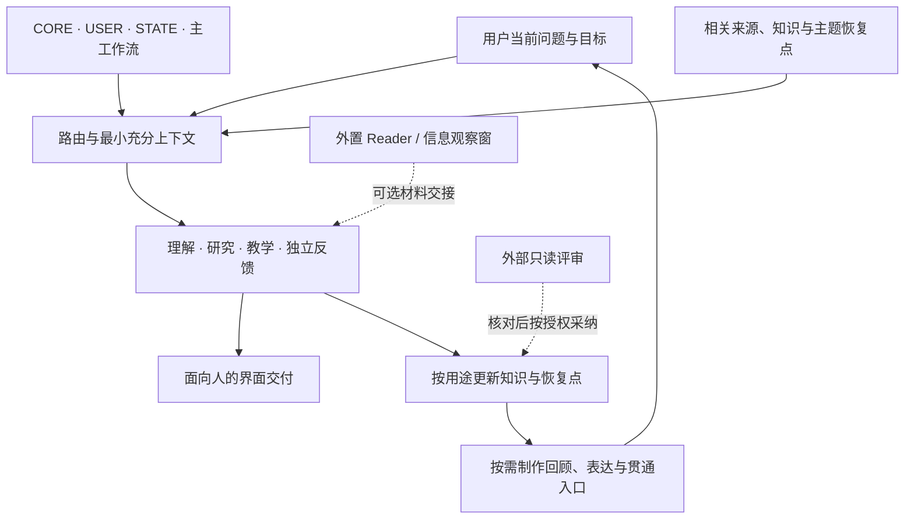

# Personal World Model Harness
[中文](README.md) · [English](README.en.md)

> **让不同领域的学习与经历，共同修正一套属于自己的世界模型。**

PWM 是一套面向长期学习与思考的个人认知协作系统：用 AI 帮助理解、研究、质疑、表达和应用，用可迁移文件保留形成过程，再让已有认识参与下一次判断。

它关注的不只是“保存了什么”，还有：**为什么这样想？后来怎样改变？现在遇到事情，能否重新想起并正确使用？**

本公开参考版依据截至 **2026-10-27** 的现行设计整理。提供可试用的 Markdown 工作区、运行协议和公开示例；私有 PWM 的工具实践另作说明，不把它们冒充本仓库已经打包的软件。

[从模板开始](template/00_System/Home.md) · [架构](docs/architecture.md) · [认知回顾](docs/human-facing-delivery.md) · [从 8 月到现在](docs/evolution.md) · [本次更新](CHANGELOG.md)

## 从“认知审计”到持续认知协作

PWM 起于一个受审计工作启发的问题：流畅的 AI 答案，会不会在没有检查来源、归属和依据的情况下，变成自己的信念？

因此，早期版本强调底稿、独立挑战、分级复核和用户采用权。这些仍是底座，但不是学习的全部。实际运行暴露了另一面：**每句话都谨慎、每个文件都合规，整堂课仍可能不好读，甚至讲偏了。** 保存完整也不等于隔一段时间还能重新理解。

现在，PWM 同时关心三件事：

- **学什么、为什么学**：好奇、理解世界、生活乐趣、创造与职业成长都可以成为目的，不把学习统一改造成收益证明。
- **怎样一起想清楚**：AI 主动解释、研究、质疑与提案；用户不必承担唯一的问题发现和验收责任，也不被固定课堂流程束缚。
- **怎样让积累真正可用**：保留来源与认识变化，提供面向人的回顾和表达入口，在新问题中调用，再随反馈修正。

用户保有目标与重要采用权；事实是否成立，仍由证据决定。审计是有用的治理类比，不是 AI 对信念拥有裁判权。

## 实际怎样使用

1. **带着问题进入一个主题**：读书、学习原理、研究行业、讨论经历或形成自己的判断。也可以只是探索，不必预先承诺成果。
2. **在界面中完成主要理解**：解释、例子、图示、交互与追问按内容组合，不要求用户再读一份后台笔记。
3. **由系统保存必要接续**：留下原话、推理、依据、当前判断与下一问题；已有知识按用途补充，不强迫每次新建资产。
4. **需要时回顾和取用**：从问题地图进入情境与解释，找回认识变化，在对应位置取得可复述表达。
5. **在后续讨论、生活或创作中再使用**：新证据可以支持、收窄、拆分或推翻旧认识。理解更具体、知道何时不能类比，也算成长。

这些是可组合的使用方式，不是每轮必须走完的流水线。

## 同一份理解，几个不同出口

| 出口 | 为谁、为什么时候服务 | 应做到什么 |
|---|---|---|
| 界面教学与讨论 | 此刻的学习者 | 看得懂、愿意读、能继续思考；关键理由在界面讲清 |
| 系统知识资产 | 下一次恢复、研究与修正 | 找得到当前判断、依据、归属和未解事项 |
| 认知回顾 | 学过但忘掉部分背景的自己 | 从熟悉问题恢复解释，而不是再看一份压缩摘要 |
| 可复述表达 | 记忆、讲述与对外沟通 | 忠实、有语境、自然可说；可以有画面、感受与余韵 |

回顾是派生的阅读资产，不是第二套独立维护的知识结论。表达被确认，也不等于相应观点已验证。详见[面向人的交付](docs/human-facing-delivery.md)。

## 架构：保留连续性，不把所有事塞进一个聊天

- **Hub** 协调系统与跨主题事项，不代替每个子话题的长期讨论。
- **STATE** 管全局当前主题、阶段与路由；**Topic Resume** 管局部结论和下一问题。两者不复制同一份待办。
- **CORE / USER / Skill / Operations / History** 分别承载原则、稳定用户信息、任务方法、条件性操作与历史。
- 默认只有一个会修改共享认知状态的实质主线；查询、维护不自动切换主线。
- 文件是持久层，编辑器与 Agent 运行环境可以更换。运行时能力、权限控制和文件协议不是同一件事。

[架构与职责](docs/architecture.md) · [上下文选择](docs/context-strategy.md) · [路由](docs/task-routing.md)

## 知识不是一条必须升级的阶梯

| 类型 | 主要用途 |
|---|---|
| Source | 保留可回查的来源；保存并不为来源真实性背书 |
| Note | 完整承载来源绑定理解、讨论演变、用户原话与恢复点 |
| Insight | 独立调用有价值的判断，保留理由、范围和证据状态 |
| Model | 能反复组织判断的方法或机制；候选与正式采用分开 |
| Case | 具体情境、行动与结果；假想例子不充当真实验证 |
| History | 解释修订和失败，不默认成为现行指令 |

Note 本身可以是完整成果。新知识也可以更新旧资产、指出领域差异或终止不成立的类比，而不是一律变得更统一、更抽象。见[资产取舍与晋升](docs/promotion-pipeline.md)。

## 外置能力：能独立使用，也能按需接入

- **Reader**：取得并审视文章、视频等材料，保留原文定位、分析和核验状态。可以独立完成有价值的阅读；进入 PWM 讨论不等于认可或入库。
- **Agent 信息观察窗**：持续关注某一领域的变化，利用已有资讯服务，再补充值得研究的解释。它不是 PWM 的课程，也不应重复建设整个新闻产品。
- **认知回顾**：私有实践中使用离线 HTML，以手动集中更新保留一个内容快照；浏览不触发模型调用。
- **外部评审**：私有实践中使用限定范围的只读连接读取 Markdown，另按需提供 HTML 和教学原文，核对实际交付而不只读规则。

这些工具的角色和交接设计见[外部能力与评审](docs/external-tools.md)。本仓库**不包含**私有 Reader、观察窗、MCP 服务、回顾生成器或真实个人网页，也不自动连接任何账号。

## 这次公开版提供什么

| 内容 | 交付情况 |
|---|---|
| 当前设计、职责、取舍与迭代说明 | 本仓库 `docs/` |
| 可复制的通用工作区、四个工作流、操作入口 | 本仓库 `template/` |
| 可从 STATE 实际找到的学习示例与恢复点 | 本仓库模板内；全部虚构演示资料 |
| 回顾层如何重写、怎样把纠正接到使用入口 | 本仓库新增公开示例 |
| 早期已获准公开的电影讨论 | 保留为标明版本的历史案例 |
| 私有工具完整代码、真实知识库、私人经历与对话 | 不随本版发布 |

四个工作流是由适配器加载的 Markdown 文件，不是宣称已经安装到某个平台的技能包。Markdown 指令也不能代替权限隔离或技术性访问控制。

## 快速试用

1. 复制 [template/](template/00_System/Home.md) 到独立工作区。
2. 让可读写工作区的 Agent 读取 `AGENTS.md`；先使用虚构 Demo，不导入私人资料。
3. 发送：“从当前主题恢复，解释为什么提醒和重建理解不同；先不要创建新 Insight。”
4. 下一轮发送：“刚才讲到哪里？继续那个未解问题。”检查能否从 Topic Resume 接上，而不是重读全库。
5. 按自己的目标修改 USER 样例。是否启用外部工具、发布内容或设置自动任务，另行决定。

无需 Obsidian 插件；Obsidian 可以查看同一批文件，不是数据库本身。模板不提供后台调度、自动上传或跨运行环境的行为保证。

## 实际进展与仍需检验的地方

原始 PWM 已出现可回查的跨会话恢复、用户纠正 AI、知识迁移和真实使用反馈；回顾工具也经历了实际页面检查与外部复核。但这些不等于证明长期学习收益、因果增益或对所有用户有效。

特别值得保留的教训是：**局部表达改好了，不代表长期教学方向就不会再次漂移。** 验收既要看成品是否可用，也要回到用户真正想理解什么。见[迭代与评估](docs/iteration-and-evaluation.md)。

公开例子：

- [从讨论到接续](examples/learning-loop/README.md)
- [回顾不只是压缩摘要](examples/cognitive-review/README.md)
- [把修正送到下次会用的位置](examples/correction-and-reuse/README.md)
- [早期资产扫描的失败与改进](examples/promotion-audit/README.md)
- [早期真实电影案例](examples/real-case-film-reflection/README.md)

## 许可

[MIT](LICENSE)。公开版可学习、修改和使用；不包含私有知识库或未授权第三方材料。发布范围与检查方法见[公开发布检查](docs/publication-checklist.md)。
