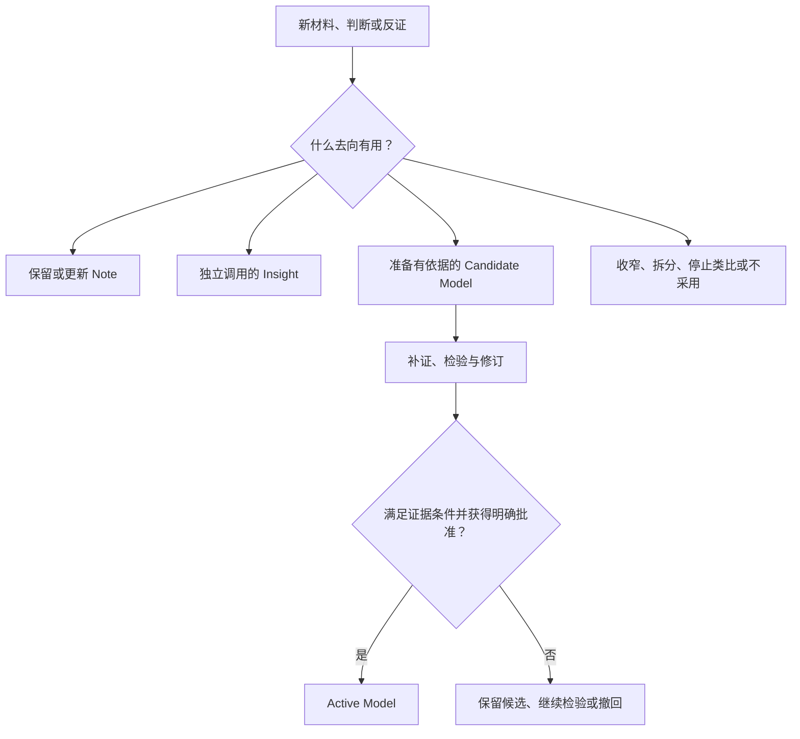

# 资产取舍与晋升
保留旧文件名供链接接续；当前设计不是必须逐级升级的 pipeline。

## 先问用途，再决定去向

Note 是完整学习成果，不是等着晋升的半成品。重复调用同一领域的判断也可能有独立价值，不必强造跨领域用途。更统一、更抽象不一定更成熟。

## Insight

判断是否有独立调用价值、推理依据、可检验性和维护净收益。保留来源、归属及适用范围，检查相关反例和现有资产。已有文件能准确承接时补充，不为每轮交付新建。

candidate 表示有依据的候选；testing 表示实际进入检验或已有局部支持，须说明发生了什么。仅写了验证计划不等于 testing，testing 也不是验证成功。

## Model

可以先准备有用途、结构和依据的 Candidate Model，列明缺口。不能把 Active 的全部要求前置，压住候选探索；也不能因为成稿成熟而跳过门槛。

正式 Active 的参考门槛：至少两个相互独立的来源、领域或现实场景支持；适用条件与失效边界；可回查的真实 Case 及反例/竞争解释；能组织判断或行动；相对已有模型有增量；用户明确批准。独立性看底层证据，不把同源转述或换场景的假想类比重复计数。

## 什么时候处理

重要新判断、支持或挑战，以及自然收束时处理相关增量。完整认知主题关闭时检查是否遗漏有价值的理解、判断方法、案例、表达、稳定偏好和跨主题输入，不设产出配额。

系统维护和普通教学推进不每轮执行全套审计。已批准的执行要接上；更正要进入下次实际读取的主句、表达与恢复点，不能只远处追加说明。

## 表达是另一种用途

可复述表达帮助记住和讲述，不承载全部论证。确认具体原句与采用意图，保留归属及影响含义的语境。助记短句和讲述版可以共存，不因新稿更流畅就把旧稿全部作废。
