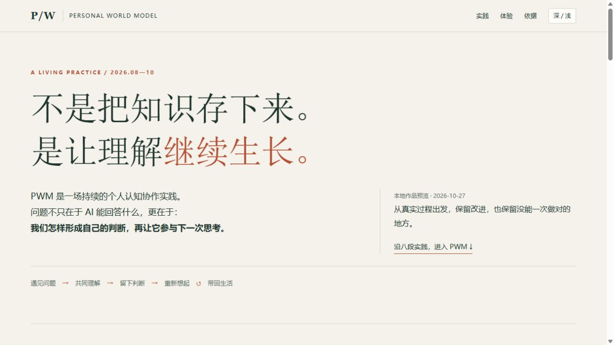
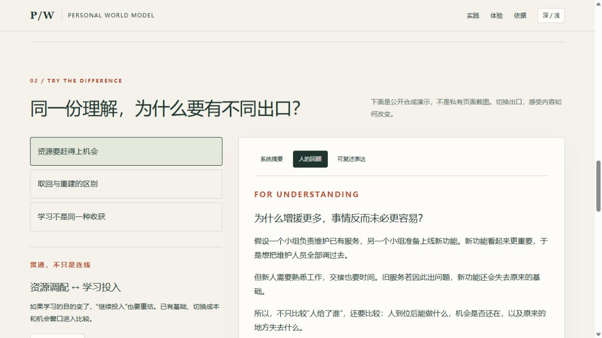

# PWM 实践作品集

> 不只是规则怎样写，而是理解怎样在真实使用中形成、改变、留下并被再次取用。

这是现行公开参考版的**实践层**：八个有依据的案例、一份可离线打开的互动展厅，以及对应的通用模板。它不替代原有架构说明，也不把私人知识库整体搬到公开仓库。

## 先看作品，再读设计

**[打开互动展厅文件](dist/index.html)** — 下载后双击即可，页面自包含，无需安装、账号或联网。GitHub 文件页只展示源码；请下载原文件到本地打开。尚未部署公开站点。



想先读三段，可以从这里开始：

1. [资源判断的贯通](cases/02-transfer.md)：用户的一个条件，怎样真正改变已有判断。
2. [回顾内容的再创作](cases/04-review.md)：为什么做好导航，还不足以恢复理解。
3. [教学专项的返修](cases/05-teaching.md)：一轮检验通过，为什么还要看真实接续。

## 八段实践

| 实践 | 要看见的变化 |
|---|---|
| [01 自主学习](cases/01-learning.md) | 从领域课程目标，走向自己为什么学、希望留下什么 |
| [02 认知贯通](cases/02-transfer.md) | 从抽象原则，走向时间、通道与相互依赖的具体判断 |
| [03 可复述表达](cases/03-expression.md) | 从精准定义，走向可以记住、自然讲给别人听的话 |
| [04 认知回顾](cases/04-review.md) | 从压缩结论，走向让忘记背景的人重新理解 |
| [05 教学与检验](cases/05-teaching.md) | 从“规则已改”，走向实际选材、讲授和接续是否有效 |
| [06 搜索与核验](cases/06-search.md) | 从保守下结论，走向主动找路径；也保留未复现的结果 |
| [07 外置工具](cases/07-tools.md) | Reader 与信息观察窗提供能力，PWM 保持认知接续职责 |
| [08 外部评审](cases/08-reviewing.md) | 从读规则和自评，走向检查真实交付、修复入口与结案 |

这些案例覆盖本轮选取的主要实践经验，不声称囊括全部私人讨论或每次小修。

## 一次小体验

展厅提供三个合成情境：资源调配、Context 取回与重建、不同学习目的。每个情境都可以切换：

**系统摘要 → 人的回顾 → 可复述表达**

还可以展开一条跨领域联系，查看它改变了什么、哪些区别仍需保留。这是公开重构的机制演示，不是私有回顾地图的缩小截图，也不是完整回顾工具的发布。



## 怎样读这些依据

案例基于实际保存的资产、试稿、验收记录及外部 AI 评审，由作者公开重构；原始私人材料不随仓库发布。[依据索引](evidence.md) 标明材料身份、时间与支持范围。

真实记录、作者的重构和合成演示分别标注。没有把用户认可写成事实验证，也没有把局部修复写成长期稳定。

## 从观看走向使用

- 想理解设计：[架构](../docs/architecture.md)、[面向人的交付](../docs/human-facing-delivery.md)、[演进](../docs/evolution.md)。
- 想自己试用：[通用工作区入口](../template/00_System/Home.md)。
- 想检查早期公开案例：[电影反思案例](../examples/real-case-film-reflection/README.md)。

## 维护这份作品

无需依赖包。修改案例与依据身份时编辑 `content.json`，再运行：

```sh
node showcase/build.mjs
node showcase/check.mjs
```

`shell.html`、`style.css`、`app.js` 分别维护结构、样式与互动。构建会生成 `dist/index.html`、`cases/*.md` 与 `evidence.md`，不要再独立维护这些生成内容。演示情境集中在 `app.js`，保持合成身份。

自动检查覆盖结构、生成一致性、相对链接及明显私密标识；内容判断和实际浏览器检查仍需完成。保持手动集中更新，不新增后台任务。

本版：2026-10-27，用户已审阅并确认发布。上述截图保留验收时的预览状态，正式页面只更新发布标记，内容与交互保持一致。
